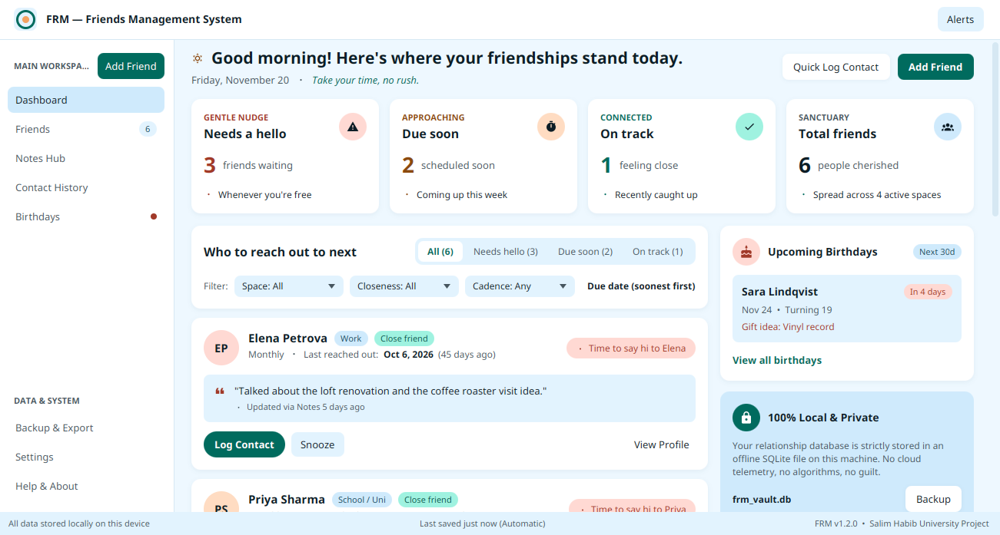
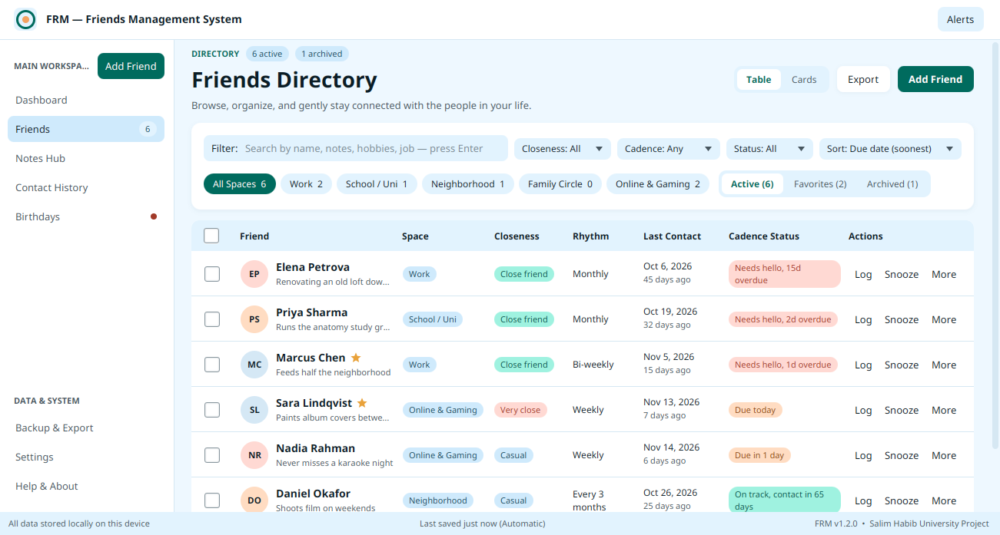
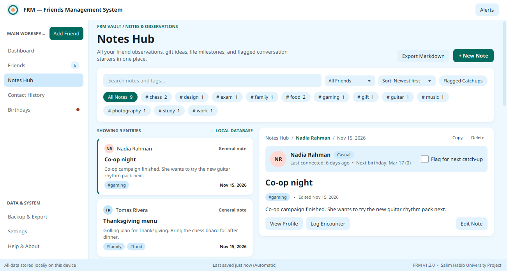
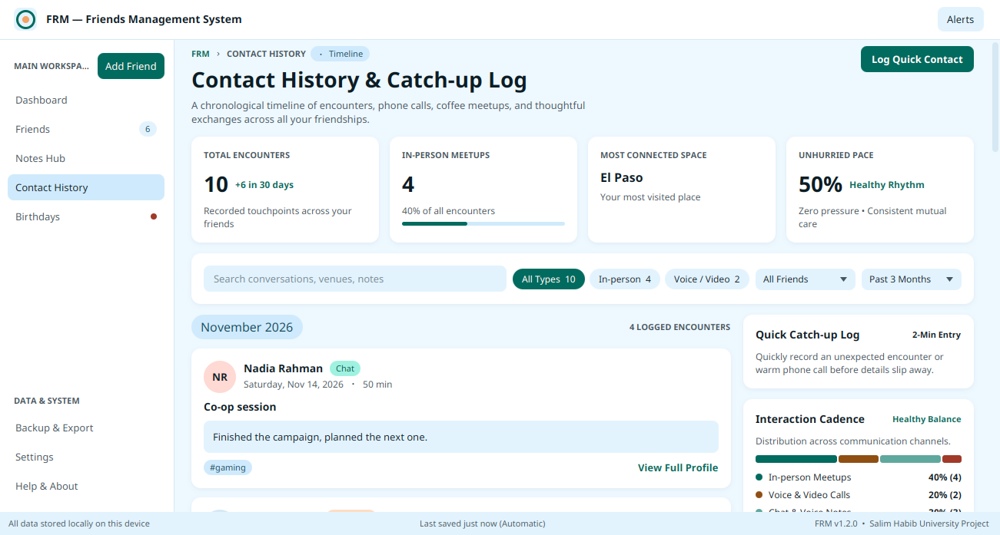
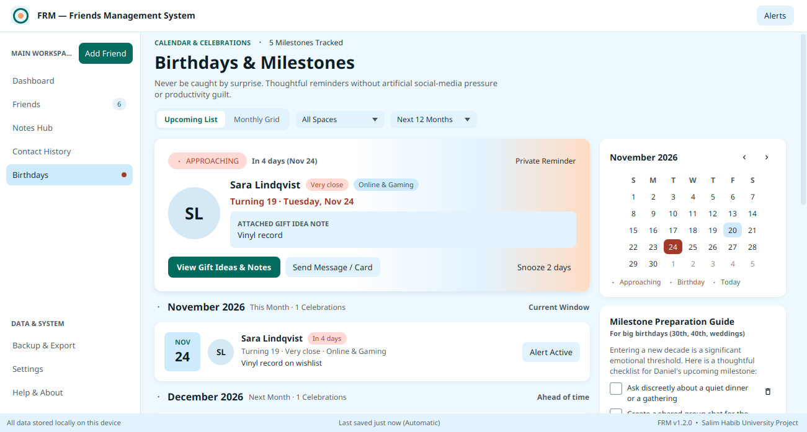
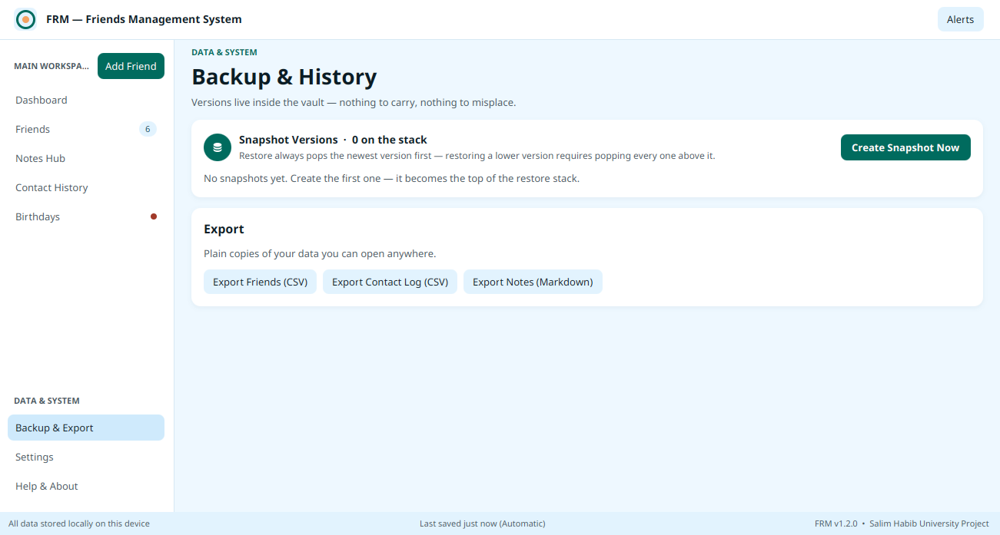
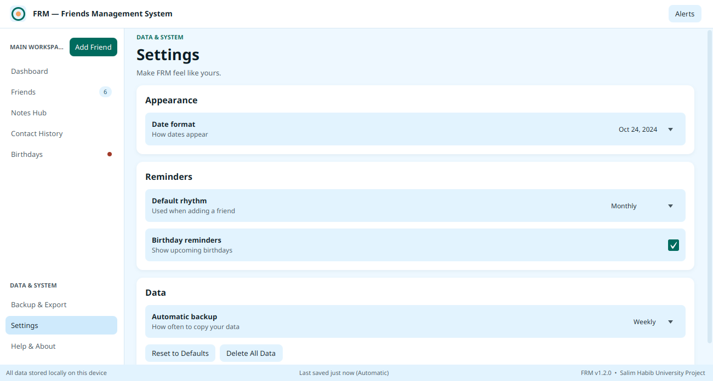
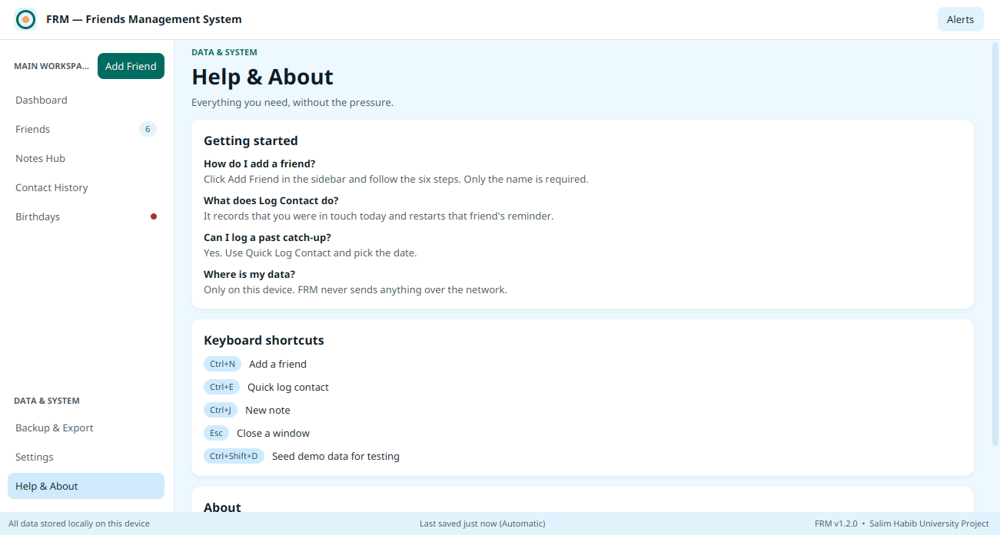
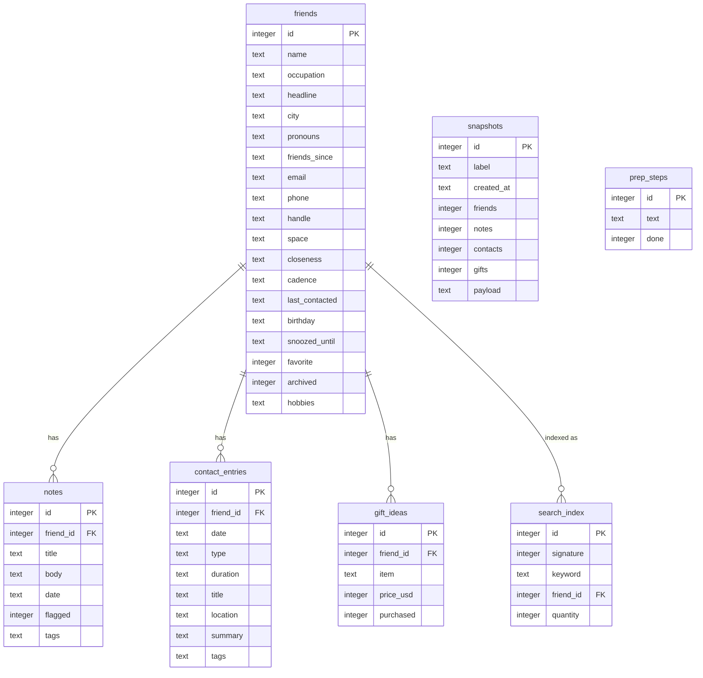

# FRM — Friends Relationship Management System

A local-first desktop application for tending real friendships: a directory of the people you care about, gentle reconnection reminders, shared memories, notes, birthdays, gift ideas, and a private full-text search engine — all stored in a single SQLite file on your own machine. No accounts, no cloud, no network calls.

Built with **JavaFX** and **SQLite** as a Data Structures final project, the app also demonstrates real, hand-implemented algorithms: a LIFO snapshot stack, a hash-signature inverted index, Levenshtein fuzzy matching, and an in-place QuickSort.

---

## Table of Contents

1. [Project Overview](#project-overview)
2. [The Problem](#the-problem)
3. [The Solution](#the-solution)
4. [Screenshots](#screenshots)
5. [Features](#features)
6. [Search Engine Design](#search-engine-design)
7. [Backup & Restore Design](#backup--restore-design)
8. [Technology Stack](#technology-stack)
9. [Database Schema](#database-schema)
10. [Project Structure](#project-structure)
11. [Requirements](#requirements)
12. [Installation](#installation)
13. [Configuration](#configuration)
14. [Execution](#execution)
15. [First Launch & Demo Data](#first-launch--demo-data)
16. [Keyboard Shortcuts](#keyboard-shortcuts)
17. [Usage Guide](#usage-guide)
18. [Testing Checklist](#testing-checklist)
19. [Troubleshooting](#troubleshooting)
20. [Limitations & Future Work](#limitations--future-work)
21. [Academic Context](#academic-context)

---

## Project Overview

FRM (Friends Relationship Management System) is a single-user desktop app that helps you maintain meaningful relationships without the noise of social media. Instead of follower counts and feeds, it tracks the things that actually keep friendships alive:

- **Who** matters to you, how close they are, and which part of life they belong to.
- **When** you last spoke, and when you should reach out again according to a cadence you choose.
- **What** you know about them — jobs, hobbies, pronouns, cities, personal notes, gifts they'd love.
- **Which** birthdays and milestones are coming up, with a preparation checklist for the big ones.

Everything lives in `frm_vault.db` next to the application. The app works fully offline: launching it never touches the network.

**Seeded demo dataset:** seven friends (Sara, Marcus, Priya, Daniel, Elena, Tomás, Nadia) with notes, check-ins, gift ideas, and dates engineered to exercise every search mode. Press `Ctrl+Shift+D` to load it — see [First Launch & Demo Data](#first-launch--demo-data).

---

## The Problem

### The human problem

Adult friendships decay silently. Nobody sends a notification that says _"you haven't spoken to your best friend from university in four months."_ Common failure modes:

1. **Out of sight, out of mind.** Contact happens only when it's convenient, so the people who matter most are often the ones we inadvertently neglect.
2. **Details slip away.** A friend mentions a new job, a partner's name, a favorite author — and months later you can't recall any of it.
3. **Guilt-inducing tools.** Social networks optimize for broadcasting and vanity metrics, not one-to-one care. Productivity apps turn relationships into a chore list.
4. **Privacy erosion.** Cloud calendars and CRMs for personal data mean your most sensitive social notes sit on someone else's servers.
5. **Scattered information.** Birthdays in one app, gift ideas in another, notes in a third, with no single place that connects them to a person.

### The technical problem

Building a good solution raises interesting data-structure questions:

1. **Fast keyword lookup** over free-text notes and profile fields, without scanning every record on every keystroke.
2. **Ranking results by relevance** — a friend whose notes mention "guitar" six times should outrank a friend whose hobby list merely contains it.
3. **Typo tolerance** — searching `fotography` should still find `photography`.
4. **Safe, undoable backups** — snapshotting and restoring database state reliably, in a defined order, with protection against mid-restore interference.
5. **In-place sorting** of ranked results by descending match frequency.

---

## The Solution

FRM addresses both sides:

| Problem                    | How FRM solves it                                                                                                                                                                               |
| -------------------------- | ----------------------------------------------------------------------------------------------------------------------------------------------------------------------------------------------- |
| Friendships decay silently | A per-friend check-in cadence (Weekly → Every 6 months) plus a dashboard of "needs hello / due soon / on track" statuses derived from `last_contacted` and the cadence                          |
| Details slip away          | Rich profiles (occupation, headline, hobbies, city, pronouns, contact info), per-friend notes with tags and "ask next time" flags, and a contact history of every catch-up                      |
| Guilt-inducing tools       | Gentle, non-judgmental language and visuals; the dashboard says _"Take your time, no rush"_ instead of red overdue counters                                                                     |
| Privacy erosion            | 100% local SQLite storage, no network stack, no telemetry; the only exit points are user-initiated file exports                                                                                 |
| Scattered information      | One profile page per person aggregates closeness, rhythm, notes, gift ideas, and encounters                                                                                                     |
| Slow search                | A persistent **inverted index** table (`search_index`) with a collision-resistant word-signature hash for exact matches, B-tree-backed prefix matching, and Levenshtein fuzzy matching          |
| Arbitrary result order     | Frequency-weighted ranking: total keyword `quantity` per friend, sorted descending with a hand-written **QuickSort** (name as tiebreak)                                                         |
| Risky backups              | In-database snapshots managed by a hand-rolled **LIFO stack** (`SnapshotStack`); only the newest snapshot can be restored, so history is consumed predictably (pop), never silently overwritten |

---

## Screenshots

All screenshots live in the [`shots/`](https://github.com/AbdullahSheikh7/friends-relationship-management-system/tree/master/shots) folder. They are embedded below via absolute raw-GitHub URLs, so the images still render when this README is viewed outside the repository (keep the `shots/` folder pushed to the default branch).

### Dashboard



_Daily overview: greeting, "who to reach out to next" with status filters, upcoming birthdays, and the local-privacy/backup tile._

### Friends Directory



_Table and card views, Enter-triggered frequency-ranked search with clear (X) button, space/closeness/cadence/status filters, favorites and archived tabs, bulk actions, and pagination._

### Notes Hub



_Every note across all friends, filterable by friend and by flagged "ask next time" reminders._

### Contact History



_Chronological log of every check-in with type, duration, location, summary, and tags._

### Birthdays & Milestones



_Upcoming list or monthly calendar, milestone detection (30th, 40th…), the preparation guide checklist, and the gift ideas registry._

### Backup & Export



_Create database snapshots (pushed onto the LIFO stack), restore the top of the stack, and export friends CSV / contact JSON / notes Markdown._

### Settings



_Default rhythm, date format, birthday reminders, automatic backup preference, reset-to-defaults, and delete-all-data._

### Help & About



_FAQ, keyboard shortcuts (including the demo data seeder), and project information._

---

## Features

### Dashboard

- Time-of-day greeting with relationship status summary.
- "Who to reach out to next" list with filters (all / needs hello / due soon / favorites) and due-date ordering.
- Upcoming birthdays panel (next 30 days).
- Local privacy tile showing the live database filename and a backup entry point.

### Friends Directory

- Table view and card view (toggle), 8 friends per page with pagination.
- **Enter-triggered search** across all profile fields and notes, ranked by keyword frequency; an **X button** clears only the text query and never touches filters.
- Filters: space (Work, School/Uni, Neighborhood, Family Circle, Online & Gaming), closeness, cadence, status; tabs: Active, Favorites, Archived.
- Sort combo for normal browsing (due date, name, last contacted) — overridden by relevance while a search is active.
- Bulk selection with archive/favorite/delete actions and export.

### Add a Friend (wizard)

Six guided steps, each holding state as you move: Closeness → Space → Basics → Interests → Rhythm → First Note.

- Closeness tiers suggest a default cadence.
- Basics covers name (required), connected since, occupation, headline, last contacted, birthday, city, phone, email. Future dates and malformed emails are rejected; name max 80 chars; duplicate names require confirmation.
- Optional first note is stored as a regular note.

### Edit Profile (single form)

Editing an existing friend skips the wizard entirely: every section appears on one scrollable form with a single **Save Changes** button. All changes persist via one `FriendDAO.update` — which also re-indexes that friend for search.

### Friend Profile

- Favorite toggle, initials avatar, headline, closeness/cadence, space.
- Rhythm card with next-due date and snooze controls.
- Basics card (contact details) and interests chips with inline hobby adding.
- Gift ideas card: add (friend preselected), toggle purchased, delete.
- Recent encounters card with a jump to full history.
- Notes tab and encounters tab with inline note composer, flags, and tags.

### Notes

- Create/edit notes with title, body, tags, and a “flag as reminder / ask next time” checkbox.
- Notes Hub aggregates all notes with friend and flag filters.
- Every note write re-indexes its friend's keywords, so new text is immediately searchable.

### Contact History

- Log a check-in (`Ctrl+E`) with date, type (In-person, Voice/Video, Chat, Letter/Card), duration, title, location, summary, and tags.
- Logging a contact updates the friend's `last_contacted` and clears snoozes.
- History page groups and displays all entries with type filters and friend search.

### Birthdays & Milestones

- List mode (next 30 days / 90 days / 12 months, space filter) and calendar grid mode with month navigation.
- Age and “turning N” computed from real dates of birth; milestone detection every 10 years.
- **Milestone Preparation Guide**: a persistent global checklist (stored in `prep_steps`), with add, toggle-done, and delete — seeded with four thoughtful defaults on first run.
- **Gift Ideas Registry**: all gift ideas across friends, with purchased toggles, an add dialog, delete (confirm-guarded), and direct navigation to the owner's profile.
- Snooze birthday reminders for two days.

### Search Engine (keyword search)

- Persistent inverted index in the `search_index` table (`keyword → friend_id, quantity`) maintained automatically by DAO hooks on friend and note create/update/delete, on backup restore, and via a startup bootstrap.
- Exact hash-signature match (×10), prefix match (`keyword LIKE 'x%'`, ×6), fuzzy Levenshtein match (×4), synonym expansion, and stop-word removal.
- Frequency-based relevance: results ordered by summed keyword quantity, descending, then by name — using an in-place QuickSort.
- Enter-only execution; the clear (X) button appears when text is present and clears only the query.

### Backup & Restore (snapshot stack)

- “Create Snapshot Now” serializes friends, notes, contact entries, and gift ideas into the `snapshots` table (payload text with escaping).
- Snapshots behave as a LIFO stack: the newest snapshot is labeled **TOP OF STACK** and is the only one restorable; older entries display **Waiting for pops**.
- Restore is transactional and rebuilds the search index; a non-removable busy overlay locks navigation and modal actions until it finishes (minimum 800 ms to avoid flicker).
- Deleting snapshots from the top maintains stack discipline.

### Data Export

- Friends → CSV, contact log → JSON, notes → Markdown, all via the system file chooser. Nothing leaves the device unless the user chooses to save a file.

### Settings

- Default check-in rhythm for new friends, date format preference, birthday reminder toggle, automatic backup preference.
- Reset to defaults (data untouched) and **Delete All Data** (double-confirmed, cascades across all tables).

### Help

- In-app FAQ, complete shortcut list, and project/version information.

---

### Word signature formula

For a keyword `w` with letters `c₁…cₙ`:

- Weights: `a…z → 1…26`, `0…9 → 27…36`
- Seed: `h₀ = 7`
- Recurrence: `hᵢ = ((hᵢ₋₁ × weight(cᵢ)) + weight(cᵢ))² mod 1,000,000,007`

Overflow safety in Java:

```java
long t = (h * weight + weight) % 1_000_000_007L; // t < 1e9+7
h = t * t % 1_000_000_007L;                      // t² < 1e18, fits in long
```

Two different strings may theoretically collide (module 1,000,000,007), but the transform mixes position, digit classes, and repeated squaring, making collisions rare in practice. The index tolerates collisions gracefully: a signature lookup returns all posting rows sharing it, and ranking uses the stored keyword text for prefix/fuzzy passes.

---

## Search Engine Design

```
User types query ──► SearchEngine.queryWords()
                     (lowercase, split on [^a-z0-9]+, drop stop words)
                              │
              ┌───────────────┼────────────────┐
              ▼               ▼                ▼
      Exact signature    Prefix LIKE      Fuzzy Levenshtein
      (×10 weight)       (×6 weight)      (×4 weight)
              │               │                │
              └───────────────┼────────────────┘
                              ▼
                  HashMap<friendId, score> scores.merge(..., quantity × weight)
                              │
                              ▼
              QuickSort: total score DESC, name ASC
                              │
                              ▼
                    FriendsView renders matches
```

**Indexing weight map** (per field, summed per keyword occurrence):

| Field                                                       | Weight |
| ----------------------------------------------------------- | ------ |
| Name                                                        | 8      |
| Occupation                                                  | 5      |
| Headline, Hobbies                                           | 4      |
| City, Note title, Note tags                                 | 3      |
| Space, Closeness label, Cadence label, Email, Phone, Handle | 2      |
| Pronouns, Friends since, Note body                          | 1–2    |

**Lifecycle:** `FriendDAO.insert/update/delete` and `NoteDAO.insert/update/delete(deleteByFriend)` call `SearchIndexDAO.reindex(friendId)`; `BackupDAO.restore` calls `rebuildAll()`; `Main` runs `SearchIndexDAO.bootstrap()` which rebuilds once if the index is empty while friend records exist.

**Search UX:** search executes only on Enter (`setOnAction`) to avoid querying on every keystroke. The X button visibility follows the text field, but its action clears only the text query and re-renders — space chips, Active/Favorites/Archived tabs, and all combo filters are preserved.

---

## Backup & Restore Design

```
Create Snapshot ──► serialize F|/N|/C|/G| records ──► INSERT INTO snapshots
                                                       (stack: top = MAX(id))

Snapshots list ──► SnapshotStack order (newest first)
   ├─ Top row:      [TOP OF STACK]  [Restore]
   └─ Older rows:   [Waiting for pops]

Restore (top only) ──► transaction: wipe live tables ──► reinsert payload
                        ──► SearchIndexDAO.rebuildAll() ──► UI refresh
```

- **Payload format:** one record per line — `F|<friend fields…>`, `N|<note…>`, `C|<contact…>`, `G|<gift…>`, with escaping (`\` → `\\`, `|` → `\p`, newline → `\n`, carriage return → `\r`).
- **Stack discipline:** restoring mutates history, so only the newest snapshot (the stack top) may be restored. Deleting snapshots is a pop from the top.
- **Safety:** the restore transaction runs with foreign keys temporarily disabled, explicit IDs are reinserted, and the whole UI is locked behind a busy modal (`RootLayout.runBusy`) with an 800 ms minimum display.
- **Search consistency:** after any restore, the inverted index is rebuilt from the restored rows.

---

## Technology Stack

| Layer               | Technology                                                                 |
| ------------------- | -------------------------------------------------------------------------- |
| Language            | Java 25 (`release=25`)                                                     |
| UI toolkit          | JavaFX 21.0.2 (`javafx-controls`)                                          |
| Icons               | Kordamp Ikonli 12.3.1 (`ikonli-javafx`, `ikonli-materialdesign2-pack`)     |
| Database            | SQLite via `org.xerial:sqlite-jdbc:3.46.0.0`                               |
| Persistence pattern | DAO classes over JDBC, one connection per operation                        |
| Build               | Apache Maven (`maven-compiler-plugin` 3.13.0, `javafx-maven-plugin` 0.0.8) |
| Styling             | Custom stylesheet `src/frmSystem/application.css`                          |
| Fonts               | Bundled Inter and Plus Jakarta Sans TTFs, loaded at startup                |
| Architecture        | Java module system (`module-info.java`) with layered packages              |

---

## Database Schema



Key properties:

- **Foreign keys** with `ON DELETE CASCADE` for notes, contacts, gifts, and index rows.
- **Indexes:** `idx_friends_name`, `idx_notes_friend`, `idx_notes_flag`, `idx_ce_friend`, `idx_ce_date`, `idx_gi_friend`, `idx_search_sig`, `idx_search_kw`, `idx_search_fid`.
- **Idempotent startup:** `CREATE TABLE IF NOT EXISTS` plus a column-level migration pass (`PRAGMA table_info` → `ALTER TABLE ADD COLUMN`) that upgrades older database files in place.
- **Enumerations stored as text:** `Closeness` (`VERY_CLOSE`, `CLOSE`, `CASUAL`), `Cadence` (`WEEKLY`, `BI_WEEKLY`, `MONTHLY`, `EVERY_3_MONTHS`, `EVERY_6_MONTHS`), `ContactType` (`IN_PERSON`, `VOICE_VIDEO`, `CHAT`, `LETTER`).
- **Derived status:** `FriendStatus` (`NEEDS_HELLO`, `DUE_SOON`, `ON_TRACK`) is computed from `last_contacted`, cadence days, and `snoozed_until` — never stored.

---

## Project Structure

```text
FriendsRelationshipManagementSystem/
├── pom.xml                     Maven build (Java 25, JavaFX 21, Ikonli, SQLite)
├── module-info.java            Module: requires javafx.controls/graphics, java.sql, ikonli.*
├── README.md                   This file
├── SRS.md                      Software Requirements Specification
├── application.css             (inside src/frmSystem) styles for the whole app
├── shots/                      Screenshots referenced above
├── frm_vault.db                SQLite database (created on first run; git-ignored)
└── src/
    └── frmSystem/
        ├── Main.java           Application entry: fonts → Database.init → index/prep bootstrap → RootLayout
        ├── application.css     Global stylesheet
        ├── fonts/              Inter + Plus Jakarta Sans TTF files
        ├── db/
        │   ├── Database.java   Connections, schema creation, migrations
        │   ├── SnapshotStack.java  Hand-rolled LIFO stack for backups (DSA)
        │   ├── TestData.java   Demo dataset seeder (Ctrl+Shift+D)
        │   ├── models/         Friend, Note, ContactEntry, GiftIdea, PrepStep,
        │   │                   Closeness, Cadence, ContactType, FriendStatus
        │   └── daos/           FriendDAO, NoteDAO, ContactEntryDAO, GiftIdeaDAO,
        │                       PrepStepDAO, SearchIndexDAO, BackupDAO
        ├── pages/
        │   ├── RootLayout.java Shell: sidebar, top bar, modals, toasts, busy lock, shortcuts
        │   └── views/
        │       ├── DashboardView.java        Overview page
        │       ├── FriendsView.java          Directory, filters, ranked search
        │       ├── FriendProfileView.java    Per-friend hub
        │       ├── AddFriendDialog.java      Add wizard + single-form editor
        │       ├── NoteDialog.java           Note create/edit
        │       ├── NotesHubView.java         All notes
        │       ├── LogContactDialog.java     Check-in logging
        │       ├── ContactHistoryView.java   Full history
        │       ├── BirthdaysView.java        Birthdays, prep guide, gift registry
        │       ├── GiftDialog.java           Gift creation
        │       ├── BackupView.java           Snapshot stack UI + exports
        │       ├── SettingsView.java         Preferences
        │       ├── HelpView.java             FAQ & shortcuts
        │       ├── SearchEngine.java         Tokenization, signature hash, synonyms, Levenshtein
        │       ├── QuickSort.java            In-place quicksort (DSA)
        │       ├── Actions.java              Shared row/menu actions
        │       └── Exports.java              CSV / JSON / Markdown file exports
        └── ui/
            ├── Theme.java      Font loading
            └── UtilsUI.java    Widget factory (labels, cards, buttons, pills, icons)
```

---

## Requirements

| Requirement | Details                                                    |
| ----------- | ---------------------------------------------------------- |
| JDK         | **Java 25** (project sets `release=25`)                    |
| Maven       | 3.9+ recommended (3.10+ fine)                              |
| OS          | Linux, Windows, or macOS with a graphical desktop (JavaFX) |
| Screen      | 960×560 minimum; starts maximized                          |
| Disk        | ~100 MB for dependencies; database grows to a few MB       |

Verify your environment:

```bash
java -version    # must report 25.x
mvn -version     # should use the same JDK
```

---

## Installation

```bash
# 1. Get the source
git clone https://github.com/AbdullahSheikh7/friends-relationship-management-system.git
cd FriendsRelationshipManagementSystem

# 2. (Optional) point Maven at JDK 25 if multiple JDKs are installed
export JAVA_HOME=/path/to/jdk-25
export PATH="$JAVA_HOME/bin:$PATH"

# 3. Download dependencies
mvn clean compile
```

No database setup is required — `frm_vault.db` is created automatically on first launch.

---

## Configuration

The application intentionally has almost no configuration surface:

| Item              | Default                                                | How to change                                                                     |
| ----------------- | ------------------------------------------------------ | --------------------------------------------------------------------------------- |
| Database file     | `frm_vault.db` in the process working directory        | Run the app from a different working directory, or copy the file to relocate data |
| Language / locale | English date labels                                    | —                                                                                 |
| Theme             | Light theme with bundled Inter/Plus Jakarta Sans fonts | Edit `src/frmSystem/application.css`                                              |
| Reminder defaults | Monthly rhythm, birthday reminders on                  | In-app **Settings** page                                                          |
| Search behavior   | Enter-triggered, frequency-ranked                      | Code-level (`FriendsView`, `SearchEngine`, `SearchIndexDAO`)                      |
| Test data         | Off                                                    | Press `Ctrl+Shift+D` inside the app (confirm dialog, adds demo friends)           |

> **Privacy note:** the app performs no network requests. Data leaves the machine only through the explicit export actions (CSV/JSON/Markdown) and user-chosen backup snapshots stored inside the same database file.

---

## Execution

### Option A — Maven (recommended, command line)

```bash
# from the project root
mvn clean javafx:run
```

The `javafx-maven-plugin` is already configured with `mainClass = frmSystem.Main`, so no flags are needed. If you override the class for any reason:

```bash
mvn javafx:run -DmainClass=frmSystem.Main
```

### Option B — Eclipse

1. **File → Import → Maven → Existing Maven Projects**, select the project root, Finish.
2. Wait for dependency resolution (`frmSystem` module appears with `module-info.java`).
3. Right-click `src/frmSystem/Main.java` → **Run As → Java Application**.
4. Ensure the project and run configuration use **JDK 25** (Project → Properties → Java Build Path → Libraries; and Run Configurations → JRE).

### Option C — Any IDE with JavaFX support

Import as a Maven project, set the JRE to JDK 25, and run `frmSystem.Main`. The Maven dependencies supply JavaFX and SQLite; no separate JavaFX SDK is required.

### Expected startup output

```text
Database Connection Successful
Database schema ready
```

The window opens maximized with the Dashboard. On first run, the `prep_steps` guide is seeded with four default steps; on the first startup after adding friends, the search index is built automatically.

---

## First Launch & Demo Data

1. Start the app — `frm_vault.db` is created next to the project (git-ignored).
2. Press **`Ctrl+Shift+D`** to seed the demo dataset (a confirm dialog protects against accidents). You can re-run it to add another copy.
3. The seed is designed to exercise every feature and search path:

| Friend         | Space           | Status             | Notable for                                                                             |
| -------------- | --------------- | ------------------ | --------------------------------------------------------------------------------------- |
| Sara Lindqvist | Online & Gaming | Favorite, on track | "guitar" frequency leader (highest rank)                                                |
| Marcus Chen    | Work            | On track           | Headline contains "work" → searching `job` finds him via synonyms; turns 30 (milestone) |
| Priya Sharma   | School / Uni    | Due soon           | "chess" leader; flagged exam note                                                       |
| Daniel Okafor  | Neighborhood    | On track           | `fotography` finds him via Levenshtein                                                  |
| Elena Petrova  | Work            | Needs hello        | Overdue monthly cadence                                                                 |
| Tomás Rivera   | Family Circle   | Archived           | Archive filter + second "chess" hit                                                     |
| Nadia Rahman   | Online & Gaming | On track           | Second, lower-frequency "guitar" hit                                                    |

**Quick search checks:** `guitar` → Sara before Nadia · `chess` → Priya before Tomás · `sar` → prefix match · `fotography` → Daniel · `job` → Marcus · `555` → everyone (phone prefix), ties by name.

**Reset everything:** Settings → Delete All Data (removes friends, cascades to notes/contacts/gifts and the search index).

---

## Keyboard Shortcuts

| Shortcut                  | Action                           |
| ------------------------- | -------------------------------- |
| `Ctrl+N`                  | Add a friend                     |
| `Ctrl+E`                  | Quick log contact                |
| `Ctrl+J`                  | New note                         |
| `Ctrl+Shift+D`            | Seed demo data (confirm-guarded) |
| `Esc`                     | Close the open modal/dialog      |
| `Enter` (in search field) | Execute the search               |

---

## Usage Guide

**A typical week with FRM**

1. Open the Dashboard — the "who to reach out to next" list shows anyone whose cadence has come due.
2. Click a person → profile → **Log Contact** (`Ctrl+E`) after you actually catch up; the reminder resets automatically.
3. Jot what you learned in a note (`Ctrl+J`) — mention their new job title, a book they loved, a gift idea. Flag notes you want to ask about next time.
4. Check Birthdays weekly: milestone years get a preparation checklist; gifts move from registry → purchased with a checkbox.
5. Search when you need context fast — `guitar`, `chess`, a city, a phone fragment; press Enter and the strongest matches rise to the top.
6. Before risky changes (bulk deletes, imports, experiments) press **Create Snapshot Now** in Backup & Export; restore the top of the stack if needed.

**Deleting data:** deleting a friend cascades to their notes, check-ins, gift ideas, and index rows — the search results reflect the removal immediately.

---

## Testing Checklist

A manual acceptance pass for the whole app (also mirrored in `SRS.md`):

- [ ] Application launches; database file is created; no console errors.
- [ ] Add Friend wizard validates name/email/future dates and saves; duplicate names prompt confirmation.
- [ ] Edit Profile opens a **single form** with all sections and a **Save Changes** button; changes persist and the wizard is not shown.
- [ ] Occupation and Headline fields are visible and editable in both flows.
- [ ] Friend statuses (needs hello / due soon / on track) match cadence math; snooze shifts the due date.
- [ ] Search: exact, prefix, fuzzy, synonym, and digit queries return expected ranking (see table above).
- [ ] Search X button clears only the text query; active space/tab/combo filters survive.
- [ ] Notes create/edit/delete update search results immediately; flagged notes surface in the Notes Hub.
- [ ] Logging a contact updates history and the friend's last-contacted/next-due values.
- [ ] Birthdays list/calendar render; milestone badge appears for turning 30/40/…; prep steps persist across restarts; gift add/purchase/delete works from registry and profile.
- [ ] Snapshot: create → label/dates/top-of-stack pill correct → restore returns data → search still works; older snapshots show "Waiting for pops".
- [ ] Busy overlay blocks navigation during backup operations and auto-dismisses.
- [ ] Exports produce CSV/JSON/Markdown via the file chooser.
- [ ] Settings: reset keeps data; Delete All Data wipes everything with confirmation.
- [ ] Demo seed (`Ctrl+Shift+D`) produces the seven-character dataset with expected birthdays/statuses.
- [ ] Restart the app: all data and settings survive.

---

## Troubleshooting

| Symptom                                              | Cause                                                                   | Fix                                                                                          |
| ---------------------------------------------------- | ----------------------------------------------------------------------- | -------------------------------------------------------------------------------------------- |
| `Unsupported class file major version 69`            | Older JDK compiling/launching                                           | Point `JAVA_HOME` and the IDE at JDK 25                                                      |
| `module not found: javafx.controls` on plain `javac` | Compiling without the Maven/JavaFX module path                          | Use `mvn javafx:run` (or IDE run config), not naked `javac`                                  |
| `Prep step insert failed` / `SQLITE_BUSY` at startup | `frm_vault.db` locked by another tool (DB Browser, second app instance) | Close the other program; the app also self-creates missing tables                            |
| Window doesn't open, stack trace mentions Main       | Wrong main class                                                        | Launch `frmSystem.Main`; the POM now sets it by default                                      |
| Search returns nothing after manual DB edits         | Index out of sync                                                       | Restart the app (bootstrap rebuilds when needed) or restore a snapshot (forces `rebuildAll`) |
| Snapshot restore refused                             | Only the stack **top** can be restored                                  | Delete newer snapshots (pop) until the desired one is on top                                 |
| Icons show as squares                                | Ikonli pack missing from module path                                    | Run via Maven/IDE with declared dependencies; ensure `ikonli-materialdesign2-pack` resolves  |

---

## Limitations & Future Work

- Single-user desktop app; no sync or multi-device support by design (privacy-first).
- QuickSort relevance ordering operates on the filtered friend list in memory — appropriate for personal-scale data (dozens to thousands of records).
- Some settings (date format, automatic backup cadence) are presentational preferences stored in the UI only.
- Candidate enhancements: FTS5-backed indexing, per-friend prep checklists, import from CSV, recurring contact scheduling, and a graph view of mutual connections (BFS).

---

## Academic Context

- **Course:** Data Structures — Final Project (3rd Semester)
- **Institution:** Salim Habib University
- **Project type:** Desktop application demonstrating data structures (stack, inverted index, hash signatures, DP, quicksort), database design, and a complete JavaFX UI.
- **Related documents:** [`SRS.md`](SRS.md) — full Software Requirements Specification (overview, scope, functional/non-functional requirements, user stories, acceptance criteria, diagrams, data dictionary).

---

## License

Developed for academic and educational use. Contact the author/instructor for reuse beyond coursework.
