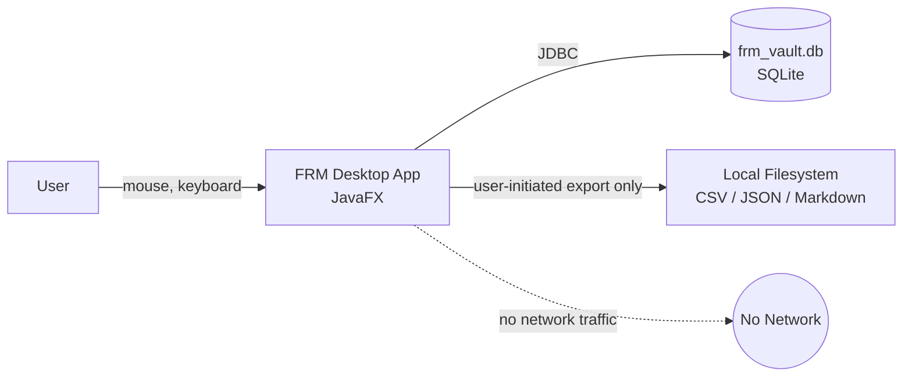
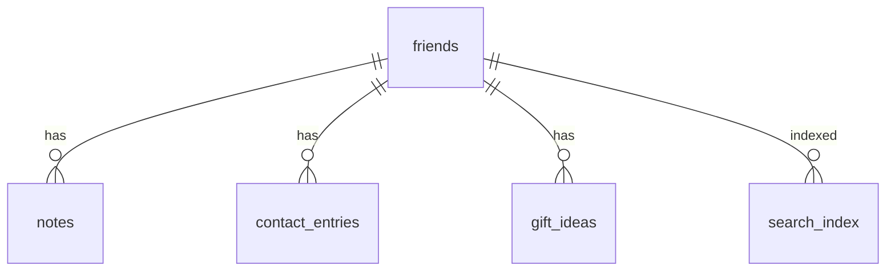
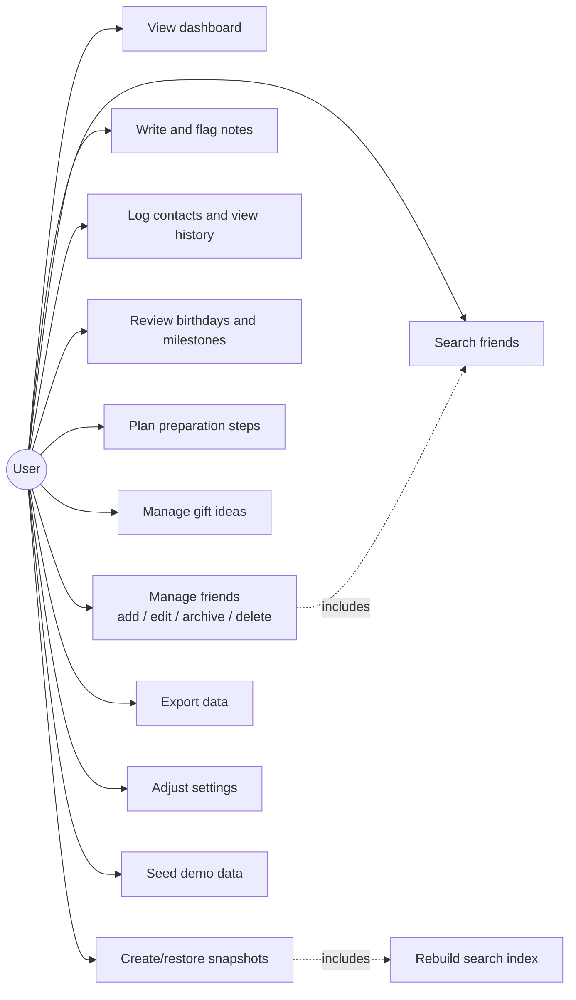
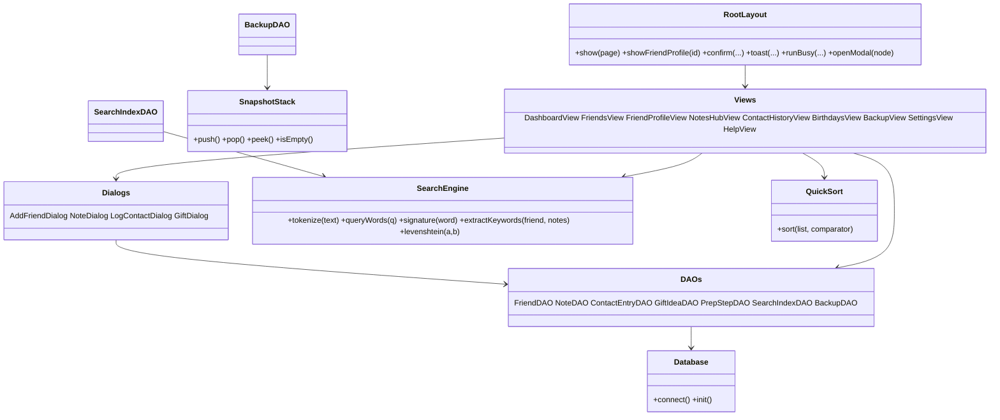
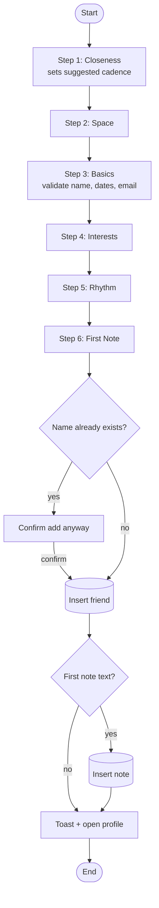
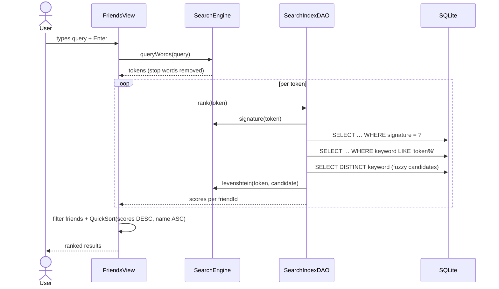
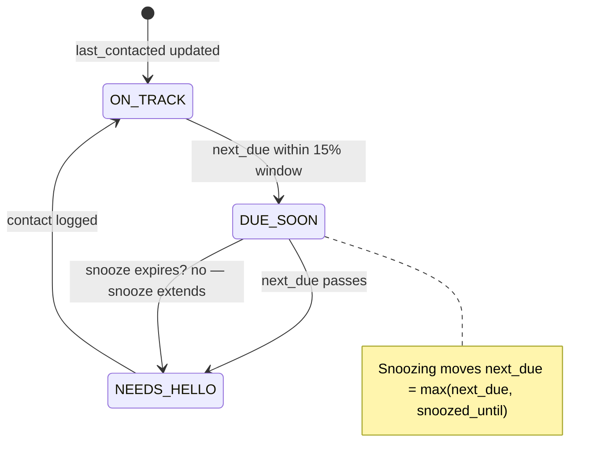

# Software Requirements Specification (SRS)
## FRM — Friends Relationship Management System

> **Document-generation instructions (for the AI that converts this file into a DOCX):**
> - Produce a formally formatted SRS following the section order below. Use heading level 1 for numbered top-level sections, level 2 for subsections, level 3 for sub-subsections.
> - Include a **title page** (project title, course, institution, student name placeholder, version 1.0, date), a **table of contents**, a **revision history table**, and **page numbers**.
> - Render every Mermaid block as an embedded figure (or redraw it as a clean vector-style diagram). Caption each figure exactly as its title line (e.g., “Figure 5 — Entity–Relationship Diagram”).
> - Insert the project screenshots from the `shots/` folder where referenced (Appendix C lists files and captions).
> - Convert all requirement identifiers (`FR-x.y`, `NFR-x`, `US-xx`, `BR-xx`) into properly numbered lists/tables and keep them stable — the Traceability Matrix references them.
> - Use tables for requirement lists, data dictionary entries, shortcut lists, and the traceability matrix.
> - Preserve technical accuracy; do not invent features beyond what this document states.

---

**Revision History**

| Version | Date | Author | Description |
|---|---|---|---|
| 0.1 | — | Development team | Initial draft (design notes) |
| 1.0 | — | Development team | Complete SRS for final submission |

---

## 1. Introduction

### 1.1 Purpose

This document specifies the requirements for **FRM (Friends Relationship Management System)**, a single-user, offline desktop application for maintaining personal friendships. It defines the product's scope, functional and non-functional requirements, user stories with acceptance criteria, data requirements, and supporting diagrams. It is intended for the course instructor as the requirements baseline for a Data Structures final project, and for future maintainers.

### 1.2 Scope

FRM is a JavaFX desktop application backed by a local SQLite database. It helps one user:

- maintain a directory of friends with rich profile details;
- track relationship closeness and check-in cadence, and derive “reach out” statuses;
- record notes (tagged, flaggable as conversation reminders);
- log and browse contact history;
- view birthdays and milestone years, maintaining a preparation checklist and gift-idea registry;
- search all friend data and notes through a persistent inverted index with frequency-based ranking, prefix matching, and typo tolerance;
- create and restore in-database snapshots governed by strict LIFO (stack) semantics;
- export data files on demand;
- seed a controlled demo dataset for testing.

**Out of scope:** multi-user accounts, cloud synchronization, networking of any kind, messaging integrations, calendar synchronization, mobile clients, encryption at rest (beyond OS-level disk protection), automated (non-manual) backups to the filesystem.

### 1.3 Definitions, Acronyms, and Abbreviations

| Term | Definition |
|---|---|
| **Friend** | A person tracked by the application (a record in `friends`). |
| **Closeness** | Relationship tier: Very close, Close friend, Casual. Implies a suggested cadence. |
| **Cadence** | Desired check-in interval: Weekly (7 d), Bi-weekly (14 d), Monthly (30 d), Every 3 months (90 d), Every 6 months (180 d). |
| **Status** | Derived state of a friend: Needs hello (past due), Due soon (within max(1, ⌊15%⌋) days of due), On track. |
| **Check-in / Contact entry** | A logged interaction (in-person, voice/video, chat, or letter/card). |
| **Note** | Free-form text attached to a friend, with tags and an optional reminder flag. |
| **Milestone** | A birthday where the friend's age is a multiple of 10. |
| **Snapshot** | A serialized copy of all live data stored inside the database; snapshots form a LIFO stack. |
| **Inverted index** | A mapping from keyword → posting list (friend, frequency) enabling fast search. |
| **Signature** | Collision-resistant numeric hash of a keyword used for exact match lookup. |
| **Levenshtein distance** | Minimum insertions/deletions/substitutions to transform one word into another (edit distance). |
| **DAO** | Data Access Object — the classes encapsulating SQL for each entity. |
| **FR / NFR / US / BR** | Functional requirement / Non-functional requirement / User story / Business rule identifiers. |
| **DSA** | Data Structures and Algorithms. |
| **UI** | User interface. |

### 1.4 References

1. IEEE Std 830-1998 — *IEEE Recommended Practice for Software Requirements Specifications* (structural basis).
2. Java 25 API documentation; JavaFX 21 documentation.
3. SQLite documentation (SQL syntax, foreign keys, indexes).
4. Project repository README (`README.md`) — installation, configuration, execution.
5. Project source code under `src/frmSystem/` (authoritative behavior reference).

### 1.5 Document Overview

Section 2 gives context and high-level capabilities. Section 3 details external interfaces. Section 4 specifies every system feature with functional requirements and acceptance criteria. Section 5 defines data requirements. Section 6 lists non-functional requirements. Section 7 presents user stories. Section 8 provides diagrams. Section 9 maps requirements to features (traceability). Appendices provide shortcuts, demo data, screenshots, algorithm specifications, and a glossary.

---

## 2. Overall Description

### 2.1 Product Perspective

FRM is a standalone product, not a component of a larger system. It replaces a patchwork of calendar reminders, notes apps, and spreadsheets with one private local vault. Key differentiators:

- **Local-first by design:** zero network communication; the only persistence is `frm_vault.db`.
- **Relationship-centric data model:** every artifact (note, contact, gift, keyword) belongs to a person.
- **Data-structure showcase:** stack-based backup history, persistent inverted index, custom hash function, dynamic-programming fuzzy matching, and in-place quicksort for ranked results.
- **Calm UX:** non-judgmental wording, gentle statuses, keyboard-first shortcuts.

**Figure 1 — System Context Diagram**



The application consists of a presentation layer (JavaFX views and dialogs), application logic (search tokenization/ranking, quicksort, snapshot stack), and a data layer (DAOs and schema management). The database resides in the process working directory.

### 2.2 Product Functions (Summary)

| # | Function group | Summary |
|---|---|---|
| F1 | Dashboard | Daily overview: greeting, prioritized outreach list, upcoming birthdays, privacy/backup tile. |
| F2 | Friends Directory | Browse, filter, sort, page, search, and bulk-manage friends in table or card view. |
| F3 | Friend Lifecycle | Add (6-step wizard), edit (single-form), view profile, favorite, archive, snooze, delete. |
| F4 | Notes | Create/edit/delete tagged notes; flag conversation reminders; aggregate hub. |
| F5 | Contact Logging | Record check-ins of four types with metadata; view chronological history. |
| F6 | Birthdays & Milestones | List/calendar views, age/milestone computation, reminder snooze. |
| F7 | Gift Ideas | Per-friend gift registry: create, mark purchased, delete; aggregate registry. |
| F8 | Preparation Guide | Persistent global checklist for milestone preparation (add/toggle/delete). |
| F9 | Search | Persistent inverted index; exact/prefix/fuzzy/synonym matching; frequency-ranked results; Enter execution; query-only clear. |
| F10 | Backup & Restore | In-database snapshots as a LIFO stack; top-only restore; busy-locked UI. |
| F11 | Exports | Friends CSV, contact log JSON, notes Markdown via file chooser. |
| F12 | Settings & Data Ops | Preferences, reset-to-defaults, delete-all-data. |
| F13 | Help | FAQ, shortcut reference, about information. |
| F14 | Demo Seeding | One-shot controlled dataset for testing every feature/search path. |
| F15 | Startup Bootstrap | Schema creation/migration, search index bootstrap, preparation-step seeding. |

### 2.3 User Characteristics

- **Primary user:** a single individual managing a personal social circle (dozens to low thousands of friends). Assumed comfortable with desktop applications; no technical skills required for daily use.
- **Secondary user:** a course instructor/demonstrator evaluating DSA concepts; expected to read code, run the app, and exercise seeded scenarios.
- No administrative roles, no concurrent users, no authentication.

### 2.4 Operating Environment

| Aspect | Requirement |
|---|---|
| OS | Linux, Windows, or macOS with a graphical desktop session |
| Runtime | JDK 25 |
| UI toolkit | JavaFX 21.0.2 (bundled via Maven dependencies) |
| Database | SQLite embedded (sqlite-jdbc 3.46.0.0) |
| Build tool | Maven (`mvn` on PATH) |
| Display | Minimum window 960×560; starts maximized |
| Locale | English UI text; dates localized by pattern choice |

### 2.5 Design and Implementation Constraints

- **CON-1:** Language level is Java 25 (`release=25`), using the Java module system (`module-info.java`).
- **CON-2:** UI must be JavaFX; no Swing/AWT-based UI components.
- **CON-3:** Persistence must be an embedded SQLite file; no external database server.
- **CON-4:** No network communication is permitted at runtime.
- **CON-5:** Data structures coursework requires hand-written implementations of the stack (backup), inverted index, hash signature, Levenshtein DP, and QuickSort — library substitutes for these are not acceptable.
- **CON-6:** Single-window shell with modal overlays (no multi-window MDI).
- **CON-7:** The database schema must be created idempotently and migrated in place for older files.

### 2.6 Assumptions and Dependencies

- **A-1:** The user runs the application in a directory where it may create/read `frm_vault.db`.
- **A-2:** The JVM provides a working graphical environment (not headless).
- **A-3:** Maven resolves JavaFX 21.0.2, Ikonli 12.3.1, and sqlite-jdbc 3.46.0.0 at build time.
- **A-4:** System clock is accurate; reminder logic depends on `LocalDate.now()`.
- **A-5:** Only one application instance accesses the database at a time.

---

## 3. External Interface Requirements

### 3.1 User Interfaces

The application is a single maximized window composed of:

1. **Top bar:** application logo, title “FRM — Friends Management System”, and an **Alerts** button that reports how many friends are waiting for a hello.
2. **Sidebar navigation:** Dashboard, Friends, Notes, History, Birthdays, Backup, Settings, Help; friend count badge; birthday-dot indicator.
3. **Content area:** the active page.
4. **Modal layer:** dialogs (add/edit friend, note, contact, gift, confirmation, busy loader, preparation-step input).
5. **Toast layer:** transient bottom-center notifications.

**UI-1:** The UI shall use a light theme with bundled fonts (Inter, Plus Jakarta Sans) and Material Design icons.
**UI-2:** All interactive controls must be operable by mouse and, where specified, keyboard shortcuts (Appendix A).
**UI-3:** Long pages shall scroll vertically; horizontal scrolling in page content is disabled.
**UI-4:** The busy loader during backup/restore shall be non-dismissable, covering navigation, modals, and Escape handling.
**UI-5:** All destructive actions shall require explicit confirmation except where stated (e.g., toggling purchased).

A screen inventory with screenshot references appears in Appendix C.

### 3.2 Hardware Interfaces

No dedicated hardware beyond a standard display, keyboard, and pointing device. No camera, microphone, printer, or sensor access.

### 3.3 Software Interfaces

| Interface | Technology | Purpose |
|---|---|---|
| JavaFX runtime | 21.0.2 | Rendering, controls, animations, file chooser |
| SQLite JDBC driver | org.xerial 3.46.0.0 | Database connectivity |
| Ikonli icon packs | 12.3.1 (Material Design 2) | Vector icons in UI |
| Local filesystem | `java.nio.file` + `FileChooser` | User-initiated exports |
| Java Preferences API | `java.prefs` (module requirement) | Reserved for local preferences |

### 3.4 Communication Interfaces

None. The application makes no HTTP, socket, RMI, or IPC calls. It must function with networking disabled.

---

## 4. System Features

Each feature lists functional requirements and acceptance criteria (testable conditions). Requirement IDs are stable and used in Section 9.

### 4.1 Dashboard (F1)

**Description:** The landing page presents a time-of-day greeting, the current date, an outreach panel (“Who to reach out to next”) with status filters, an upcoming-birthdays panel for the next 30 days, and a privacy/backup tile showing the database filename.

**Functional requirements**

- **FR-1.1** The dashboard shall greet the user according to local time (morning/afternoon/evening).
- **FR-1.2** The outreach panel shall list non-archived friends ordered by next-due date (soonest first).
- **FR-1.3** The outreach panel shall offer status filters (All, Needs hello, Due soon, Favorites) and reflect the currently selected filter without reloading the app.
- **FR-1.4** Each row shall display avatar/initials, name, headline, last-reached-out information (days since contact), and actionable buttons (reach out / view profile).
- **FR-1.5** The birthdays panel shall show friends with birthdays within 30 days, ordered by proximity, with “turning N” computed from date of birth.
- **FR-1.6** The privacy tile shall display the live database filename (`frm_vault.db`) and provide a shortcut to Backup.

**Acceptance criteria**

- With seeded data, Elena appears under “Needs hello”, Priya under “Due soon”, others under “On track”.
- With the demo dataset seeded in late November, Sara (November 24) appears in the upcoming-birthdays panel.
- Switching filters updates the list immediately and shows an empty state when no friend matches.

### 4.2 Friends Directory (F2)

**Description:** The directory lists friends in table or card layout with filters, sorting, pagination, bulk actions, and ranked search.

**Functional requirements**

- **FR-2.1** The directory shall offer Table and Cards views, switchable without losing filter state.
- **FR-2.2** Tabs shall segment Active (default), Favorites, and Archived friends.
- **FR-2.3** Filters shall include Space (Work; School / Uni; Neighborhood; Family Circle; Online & Gaming; custom values present in data), Closeness, Cadence, and Status; each filter offers an “All/Any” option.
- **FR-2.4** Normal browsing shall support sorting by due date (default), name, and last contacted.
- **FR-2.5** Pagination shall display 8 friends per page with working previous/next controls.
- **FR-2.6** Search shall execute only on Enter (no per-keystroke querying) and shall replace sort-combo ordering with relevance ordering while active.
- **FR-2.7** A clear (X) control shall be visible only when query text exists; activating it shall clear the text query only — space chips, group tabs, and filter combos shall remain unchanged.
- **FR-2.8** Bulk selection shall enable archive, favorite, and delete actions for selected friends, with confirmation for deletion.
- **FR-2.9** The header shall provide Add Friend and Export (CSV) actions.

**Acceptance criteria**

- Searching `guitar` returns Sara before Nadia; `chess` returns Priya before Tomás; `sar` matches via prefix; `fotography` matches Daniel via fuzzy logic.
- After clicking X, results return to the selected sort order and all chips/combos remain set.
- Selecting Archived tab shows only archived friends (e.g., Tomás after seeding).

### 4.3 Add Friend Wizard (F3a)

**Description:** A six-step guided flow that keeps state across steps: (1) Closeness, (2) Space, (3) Basics, (4) Interests, (5) Rhythm, (6) First Note.

**Functional requirements**

- **FR-3.1** Step navigation shall be Next/Back with a step bar; clicking a completed step (or any step when current validation passes) shall jump to it.
- **FR-3.2** Selecting a closeness tier shall preselect its suggested cadence (Very close → Bi-weekly; Close friend → Monthly; Casual → Every 3 months).
- **FR-3.3** Space selection shall offer the five predefined spaces and accept a custom space via free text.
- **FR-3.4** Basics shall capture name (required, ≤80 chars), connected-since text, occupation, headline (optional tagline, falls back to occupation when blank), last contacted date (not in the future), birthday (not in the future), city, phone, and email (format-validated when present).
- **FR-3.5** Interests shall accept comma-separated hobbies.
- **FR-3.6** Rhythm shall offer all five cadences with the recommended one for the chosen closeness indicated.
- **FR-3.7** The final step shall accept an optional first note, stored as a normal note titled “First note”.
- **FR-3.8** On save, a duplicate-name check shall prompt confirmation before creating a second friend with the same (case-insensitive) name.
- **FR-3.9** Saving shall insert the friend, insert the optional note, close the wizard, show a toast, and navigate to the new friend’s profile.
- **FR-3.10** Field-level validation errors shall be displayed inline without losing entered data.

**Acceptance criteria**

- Attempting to advance from Basics with an empty name shows “Please add a name or nickname.”
- Entering a future birthday shows “Birthday can't be in the future.”
- Adding “Sara Lindqvist” when one exists prompts confirmation; declining returns to the form.

### 4.4 Edit Profile (F3b)

**Description:** Editing an existing friend must not reuse wizard navigation. It presents every editable section on a single scrollable form with one save action.

**Functional requirements**

- **FR-4.1** Edit mode shall render without the step bar, Back/Next buttons, or step counter.
- **FR-4.2** The form shall contain, in order: closeness tiers, space selection, basics grid (including occupation and headline), hobbies, and check-in rhythm.
- **FR-4.3** The footer shall contain exactly two actions: Cancel and **Save Changes**.
- **FR-4.4** Save Changes shall apply full validation (same rules as FR-3.4) and persist via a single friend update.
- **FR-4.5** All pre-existing values shall be prefilled, including occupation and headline.
- **FR-4.6** Saving shall synchronously update the search index for that friend.
- **FR-4.7** The first-note section shall not appear in edit mode.

**Acceptance criteria**

- Opening Edit from a profile shows a single form with a “Save Changes” button and no wizard controls.
- Changing occupation and headline and saving reflects immediately in the profile, directory cards, and search results (e.g., new occupation keyword becomes searchable).

### 4.5 Friend Profile (F3c)

**Description:** A per-friend hub aggregating header identity, rhythm, basics, interests, gift ideas, recent encounters, and notes.

**Functional requirements**

- **FR-5.1** The header shall show initials avatar, name, headline, favorite toggle (star), and record identifier.
- **FR-5.2** A rhythm card shall display next-due date and provide snooze controls.
- **FR-5.3** A basics card shall display contact details and provide an Edit entry to the edit form.
- **FR-5.4** An interests card shall display hobby chips and allow adding a hobby inline (persisted immediately).
- **FR-5.5** A gift ideas card shall list the friend’s gifts with purchased toggles, an Add Gift Idea action (friend preselected), and per-row delete with confirmation.
- **FR-5.6** A recent encounters card shall show the latest entries and link to full contact history.
- **FR-5.7** Notes shall be listable and composable in-profile with flag and tag support.

**Acceptance criteria**

- Adding a gift from the profile associates it with that friend without requiring selection.
- Marking a gift purchased persists after navigation and restart.
- Deleting a gift requires confirmation and removes it from the registry and profile.

### 4.6 Notes (F4)

**Description:** Tagged notes attached to friends, optionally flagged as “ask next time”; an aggregated Notes Hub lists all notes.

**Functional requirements**

- **FR-6.1** Note creation shall require a selected friend and non-empty body; title defaults to “Note” when blank.
- **FR-6.2** Notes shall support comma-separated tags (trimmed, `#` stripped, empties ignored) and a flagged checkbox.
- **FR-6.3** Editing a note shall allow changing friend association, title, body, tags, and flag.
- **FR-6.4** Note insert/update/delete shall re-index the affected friend(s), including both old and new friend when reassigned.
- **FR-6.5** The Notes Hub shall list all notes, filterable by friend and flagged status.
- **FR-6.6** Deleting a friend shall cascade-delete their notes.

**Acceptance criteria**

- After adding a note containing “badminton”, searching `badminton` finds the friend.
- Moving a note from friend A to friend B removes A’s keyword contribution and adds B’s.
- Flagged notes appear under the flagged filter and show the reminder treatment in the profile.

### 4.7 Contact Logging & History (F5)

**Description:** Logging check-ins with type, date, duration, title, location, summary, and tags; a history page renders all entries chronologically.

**Functional requirements**

- **FR-7.1** The quick-log dialog shall be reachable via `Ctrl+E` and from relevant row actions; it shall accept a friend (or come preselected) and a date (default today, not in the future).
- **FR-7.2** Type options shall be In-person Meetup, Voice Call, Chat, and Letter / Card.
- **FR-7.3** On save, the friend’s last-contacted date shall be set to the entry date and any snooze cleared.
- **FR-7.4** The history page shall display entries newest-first with type filters and friend search.
- **FR-7.5** Deleting a friend shall cascade-delete their contact entries.

**Acceptance criteria**

- Logging a contact today changes the friend’s status per cadence math and updates dashboard ordering.
- History shows the seeded check-ins with correct types, dates, and metadata.

### 4.8 Birthdays & Milestones (F6)

**Description:** A birthdays workspace with list and calendar modes, horizon and space filters, milestone highlighting, and reminder snooze.

**Functional requirements**

- **FR-8.1** List mode shall group friends with birthdays within the selected horizon (30 days / 90 days / 12 months).
- **FR-8.2** Calendar mode shall render the current month with day cells and birthday pills; month navigation shall work.
- **FR-8.3** Ages (“turning N”) and milestone badges (every 10 years) shall be computed from stored dates of birth.
- **FR-8.4** Friends without a birthday shall not appear.
- **FR-8.5** “Snooze 2 days” shall postpone the birthday reminder toast/notification for that friend.
- **FR-8.6** Actions on a birthday row shall include opening the profile, logging a message/card, and creating a note.

**Acceptance criteria**

- With seed data, Sara appears in the list inside the 30-day horizon; Marcus shows a 30th-milestone badge.
- Calendar navigation across months keeps working; archived friends are excluded.

### 4.9 Gift Ideas (F7)

**Description:** Gift planning per friend and across all friends.

**Functional requirements**

- **FR-9.1** A gift idea shall consist of friend, item description (required), price in whole USD (optional, ≥0), and purchased state (default false).
- **FR-9.2** The gift dialog shall preselect the friend when opened from a profile; from the registry it shall offer active friends alphabetically.
- **FR-9.3** The registry shall list all ideas with owner and birthday information, purchased toggles (persisting immediately), and the count of unpurchased items.
- **FR-9.4** Delete shall be available per row in both registry and profile, guarded by confirmation.
- **FR-9.5** Price input shall reject non-numeric and negative values with inline errors.
- **FR-9.6** Deleting a friend shall cascade-delete their gift ideas.

**Acceptance criteria**

- Adding “Vinyl record” at $25 for Sara appears in both the registry and her profile.
- Entering “abc” as price shows “Price must be a whole number.”

### 4.10 Milestone Preparation Guide (F8)

**Description:** A persistent global checklist used to plan milestone birthdays, replacing the former session-only placeholder.

**Functional requirements**

- **FR-10.1** Steps shall be stored in the database (`prep_steps`) with text and done state.
- **FR-10.2** On startup, if no steps exist, four default steps shall be seeded.
- **FR-10.3** Checking/unchecking a step shall persist immediately.
- **FR-10.4** “+ Add preparation step” shall open a modal that accepts non-empty text and inserts a new step.
- **FR-10.5** Each step shall offer delete, guarded by confirmation.
- **FR-10.6** Steps shall render in insertion order and survive restarts.
- **FR-10.7** No placeholder toast claiming the feature is unavailable shall remain.

**Acceptance criteria**

- Adding a step and restarting preserves the step and its done state.
- Deleting the last step and restarting does not silently recreate defaults unless the table is empty at startup (bootstrap rule).

### 4.11 Search Engine (F9)

**Description:** A persistent inverted index and ranking pipeline over all friend fields and notes, with exact, prefix, fuzzy, and synonym matching.

**Functional requirements**

- **FR-11.1** The system shall maintain a `search_index` table mapping `(keyword, friend_id) → quantity`, with a numeric `signature` per keyword.
- **FR-11.2** Keyword extraction shall tokenize text case-insensitively on non-alphanumeric runs and remove stop words for indexing; query parsing shall also drop stop words but retain single characters for prefix matching.
- **FR-11.3** Field weights shall apply: name 8; occupation 5; headline and hobbies 4; city, note title 3; note tags 3; space, closeness label, cadence label, email, phone, handle 2; pronouns, friends-since 1; note body 2.
- **FR-11.4** The signature shall be computed as: weights a–z = 1–26, 0–9 = 27–36; h₀ = 7; hᵢ = ((hᵢ₋₁ × wᵢ) + wᵢ)² mod 1,000,000,007.
- **FR-11.5** Ranking shall combine: exact signature matches ×10; keyword-prefix matches ×6; fuzzy matches ×4; synonyms as exact matches. Each contributes `quantity × multiplier`, summed per friend.
- **FR-11.6** Fuzzy matching shall consider only indexed keywords of ≥4 characters sharing the first letter and length difference bounded by the edit limit (1 for 4–5 chars, 2 for longer), accepting Levenshtein distance within the limit.
- **FR-11.7** Results shall be ordered by total score descending, then name ascending, using the project’s hand-written QuickSort.
- **FR-11.8** Writes that affect indexed text (friend insert/update/delete; note insert/update/delete/delete-by-friend; backup restore) shall refresh the affected index automatically.
- **FR-11.9** Startup shall bootstrap the index (rebuild once if friend records exist while the index is empty).
- **FR-11.10** Search shall execute on Enter only; the X control shall clear only query text.

**Acceptance criteria**

- `guitar` ranks Sara (quantity ≈16) above Nadia (≈6).
- `555` matches all seeded friends via their phone tokens; equal scores fall back to name order.
- `job` matches Marcus through the “work” synonym recorded in his headline.
- Index writes are idempotent per friend (delete-then-insert within a transaction).

### 4.12 Backup & Restore (F10)

**Description:** Snapshots stored inside the database, ordered strictly as a LIFO stack; only the stack top is restorable.

**Functional requirements**

- **FR-12.1** Creating a snapshot shall serialize friends, notes, contact entries, and gift ideas into a single payload row with counts and a local timestamp, labeled “Snapshot — <timestamp>”.
- **FR-12.2** The snapshots list shall present newest first; the newest shall carry a “TOP OF STACK” badge and a Restore action; others shall display “Waiting for pops” with no restore action.
- **FR-12.3** Restore shall be transactional: wipe live tables, then reinsert payload rows with original identifiers; foreign keys shall not block the operation.
- **FR-12.4** Restore shall rebuild the search index for the restored data.
- **FR-12.5** All backup operations shall run behind a non-dismissable busy overlay (minimum display 800 ms) that blocks page navigation, profile opening, and modal closing.
- **FR-12.6** Failures shall surface as an error toast (“The backup operation failed. Try again.”) without corrupting live data.
- **FR-12.7** Deleting snapshots shall preserve stack semantics (removal from the top order).
- **FR-12.8** The payload format shall escape separator characters: `\` → `\\`, `|` → `\p`, newline → `\n`, carriage return → `\r`.

**Acceptance criteria**

- Creating a snapshot then deleting a friend, then restoring, returns the friend and makes them searchable again.
- Attempting any backup action during a restore is blocked by the overlay.
- Cancel/close during the loader is impossible (no close control; Escape is ignored while busy).

### 4.13 Data Exports (F11)

**Description:** User-initiated file exports.

**Functional requirements**

- **FR-13.1** Friends export shall produce a CSV file via the system save dialog with a default filename.
- **FR-13.2** Contact log export shall produce a JSON file.
- **FR-13.3** Notes export shall produce a Markdown file.
- **FR-13.4** Cancelling the file dialog shall perform no action. I/O failures shall show a friendly toast (“Couldn't save that file. Try another folder.”).
- **FR-13.5** Export paths are user-chosen; nothing is exported implicitly.

**Acceptance criteria**

- Exporting friends creates a readable CSV whose rows correspond to the directory.
- Cancelling the dialog leaves the filesystem untouched.

### 4.14 Settings & Data Operations (F12)

**Functional requirements**

- **FR-14.1** Settings shall expose default rhythm (for new friends), date-format preference, birthday-reminder toggle, and an automatic-backup preference (presentational).
- **FR-14.2** “Reset to Defaults” shall restore default preference values without deleting data, after confirmation.
- **FR-14.3** “Delete All Data” shall require confirmation and delete every friend (cascading to notes, contacts, gifts, index rows) and the toast shall confirm completion.
- **FR-14.4** The navigation shall not expose a profile button; Settings is reachable from the sidebar.

**Acceptance criteria**

- After Delete All Data, the directory is empty and searches return no results.
- Reset leaves friends/notes intact.

### 4.15 Help (F13)

- **FR-15.1** Help shall include FAQ entries covering adding friends, logging contacts, past catch-ups, and data locality.
- **FR-15.2** Help shall list every keyboard shortcut, including the demo seeder.
- **FR-15.3** Help shall display version and institutional information.

### 4.16 Demo Data Seeder (F14)

- **FR-16.1** `Ctrl+Shift+D` shall open a confirmation dialog describing the seed contents.
- **FR-16.2** On confirmation, the system shall insert seven friends, eight notes, eleven check-ins, and seven gift ideas through the standard DAOs (thus exercising index hooks).
- **FR-16.3** The dataset shall be deterministic in composition (names, statuses, search-relevant frequencies) and shall produce a summary toast.
- **FR-16.4** Re-running the seeder shall append another copy of the dataset without error.

**Acceptance criteria**

- After seeding, the search expectations in FR-11 hold, statuses include one Needs hello, one Due soon, one Archived, one Favorite, and one milestone friend.
- Dates of birth are in the past (e.g., Sara 2007-11-24, Priya 2005-12-26).

### 4.17 Startup & Bootstrapping (F15)

- **FR-17.1** Startup shall ensure schema existence idempotently, including table migrations for older files.
- **FR-17.2** Startup shall bootstrap the search index (conditional rebuild) and seed preparation steps when empty.
- **FR-17.3** Startup failures of optional subsystems (e.g., preparation seeding) shall not leave unrecoverable state; the system shall self-heal missing tables at the component level.
- **FR-17.4** The main window shall open maximized at no less than the minimum supported size.

---

## 5. Data Requirements

### 5.1 Entity–Relationship Diagram

**Figure 5 — Entity–Relationship Diagram**



`snapshots` and `prep_steps` are standalone tables (no foreign keys).

### 5.2 Data Dictionary

**Table `friends`**

| Column | Type | Constraints / Notes |
|---|---|---|
| id | INTEGER | PK, AUTOINCREMENT |
| name | TEXT | NOT NULL, default `''` |
| occupation | TEXT | default `''` |
| headline | TEXT | default `''`; tagline shown under the name |
| city | TEXT | default `''` |
| pronouns | TEXT | default `''` |
| friends_since | TEXT | free text, default `''` |
| email | TEXT | default `''`; validated when non-empty |
| phone | TEXT | default `''` |
| handle | TEXT | default `''` |
| space | TEXT | default `'Work'`; preset or custom |
| closeness | TEXT | one of `VERY_CLOSE`, `CLOSE`, `CASUAL`; default `CLOSE` |
| cadence | TEXT | one of `WEEKLY`, `BI_WEEKLY`, `MONTHLY`, `EVERY_3_MONTHS`, `EVERY_6_MONTHS`; default `MONTHLY` |
| last_contacted | TEXT | ISO date, NOT NULL, default `date('now')` |
| birthday | TEXT | ISO date or NULL (date of birth) |
| snoozed_until | TEXT | ISO date or NULL |
| favorite | INTEGER | 0/1, default 0 |
| archived | INTEGER | 0/1, default 0 |
| hobbies | TEXT | `|`-separated list |

**Table `notes`**

| Column | Type | Constraints / Notes |
|---|---|---|
| id | INTEGER | PK, AUTOINCREMENT |
| friend_id | INTEGER | NOT NULL, FK → friends(id) ON DELETE CASCADE |
| title | TEXT | default `''` |
| body | TEXT | default `''` |
| date | TEXT | ISO date, NOT NULL, default `date('now')` |
| flagged | INTEGER | 0/1 “ask next time” |
| tags | TEXT | `|`-separated list |

**Table `contact_entries`**

| Column | Type | Constraints / Notes |
|---|---|---|
| id | INTEGER | PK, AUTOINCREMENT |
| friend_id | INTEGER | NOT NULL, FK → friends(id) ON DELETE CASCADE |
| date | TEXT | ISO date, NOT NULL |
| type | TEXT | `IN_PERSON`, `VOICE_VIDEO`, `CHAT`, `LETTER` |
| duration | TEXT | free text (e.g., “40 min”) |
| title | TEXT | short label |
| location | TEXT | free text |
| summary | TEXT | free text |
| tags | TEXT | `|`-separated list |

**Table `gift_ideas`**

| Column | Type | Constraints / Notes |
|---|---|---|
| id | INTEGER | PK, AUTOINCREMENT |
| friend_id | INTEGER | NOT NULL, FK → friends(id) ON DELETE CASCADE |
| item | TEXT | default `''` |
| price_usd | INTEGER | whole USD ≥ 0 |
| purchased | INTEGER | 0/1 |

**Table `snapshots`**

| Column | Type | Constraints / Notes |
|---|---|---|
| id | INTEGER | PK, AUTOINCREMENT; MAX(id) = stack top |
| label | TEXT | NOT NULL (“Snapshot — <timestamp>”) |
| created_at | TEXT | NOT NULL, default local datetime |
| friends / notes / contacts / gifts | INTEGER | row counts at capture time |
| payload | TEXT | NOT NULL; escaped `F|`/`N|`/`C|`/`G|` records joined by newlines |

**Table `search_index`**

| Column | Type | Constraints / Notes |
|---|---|---|
| id | INTEGER | PK, AUTOINCREMENT |
| signature | INTEGER | NOT NULL; word signature (Section 4.11) |
| keyword | TEXT | NOT NULL; lowercase token |
| friend_id | INTEGER | NOT NULL, FK → friends(id) ON DELETE CASCADE |
| quantity | INTEGER | NOT NULL, default 1; summed field weights |

**Table `prep_steps`**

| Column | Type | Constraints / Notes |
|---|---|---|
| id | INTEGER | PK, AUTOINCREMENT |
| text | TEXT | NOT NULL |
| done | INTEGER | NOT NULL, default 0 |

**Indexes:** `idx_friends_name` (name NOCASE), `idx_notes_friend`, `idx_notes_flag(friend_id, flagged)`, `idx_ce_friend`, `idx_ce_date`, `idx_gi_friend`, `idx_search_sig`, `idx_search_kw`, `idx_search_fid`.

### 5.3 Business Rules

- **BR-1** Status derivation: `next_due = last_contacted + cadence_days` (or `snoozed_until` if later); `NEEDS_HELLO` if `next_due < today`; `DUE_SOON` if `next_due − today ≤ max(1, round(cadence_days × 0.15))`; otherwise `ON_TRACK`.
- **BR-2** Archived friends are excluded from dashboard outreach counts, birthdays lists, and default directory view; they remain searchable only under the Archived tab context.
- **BR-3** Search index rows are a pure function of current friend + note content; any write path must reindex the affected friend.
- **BR-4** Snapshot restore order is strictly LIFO; no out-of-order restores.
- **BR-5** Deleting a friend cascades to all dependent records.
- **BR-6** Birthdays must be dates of birth, not “next occurrence” placeholders; future dates are rejected at input.

---

## 6. Non-Functional Requirements

### 6.1 Performance

- **NFR-1** Directory rendering and filtering for 1,000 friends shall complete within 200 ms on a typical laptop.
- **NFR-2** Search ranking shall complete within 300 ms for 1,000 friends with typical note volumes (exact/prefix queries use indexed lookups; fuzzy candidate enumeration is bounded by the distinct keyword set).
- **NFR-3** Index maintenance per friend write shall complete within 100 ms; batch inserts shall be used for reindexing.
- **NFR-4** The busy overlay shall appear immediately and remain for at least 800 ms to avoid flicker on fast operations.

### 6.2 Reliability & Availability

- **NFR-5** Database initialization shall be idempotent; repeated startups never destroy data.
- **NFR-6** Restores shall be atomic (all-or-nothing).
- **NFR-7** Corrupt/partial schemas shall be self-healed where feasible (table creation at component level), and failure messages shall be user-readable.
- **NFR-8** The application shall not crash on invalid input; validation errors appear inline.

### 6.3 Security & Privacy

- **NFR-9** No network communication at runtime.
- **NFR-10** No credentials or secrets are stored or transmitted.
- **NFR-11** SQL shall use prepared statements with bound parameters (injection-safe).
- **NFR-12** Data is only written to the chosen database file and user-selected export paths.

### 6.4 Usability

- **NFR-13** All primary workflows shall be reachable within two interactions from the sidebar/dashboard.
- **NFR-14** Destructive actions require confirmation; the cancel option is always available except during the busy lock.
- **NFR-15** The UI shall use plain, non-judgmental language and consistent visual hierarchy.
- **NFR-16** Keyboard shortcuts shall exist for add friend, log contact, new note, close modal, and demo seeding.
- **NFR-17** Empty states shall explain what to do next.

### 6.5 Maintainability

- **NFR-18** Code shall follow a layered structure: models, DAOs, views, UI utilities.
- **NFR-19** Schema changes shall be applied via the migration mechanism, never by manual deletion of user databases.
- **NFR-20** Algorithms required by the course (stack, quicksort, hash signature, Levenshtein) shall exist as isolated, documented classes.

### 6.6 Portability

- **NFR-21** The application shall run on any JDK 25 desktop platform supported by JavaFX.
- **NFR-22** No platform-specific paths shall be hard-coded (database filename is relative).

### 6.7 Data Integrity

- **NFR-23** Foreign keys shall be enforced (`PRAGMA foreign_keys = ON` per connection) with cascade deletes.
- **NFR-24** The search index shall never contain rows for deleted friends or stale friend content after any supported write path.
- **NFR-25** All multi-step writes (reindex, restore) shall execute inside transactions.

---

## 7. User Stories and Acceptance Criteria

Format: **US-ID — story** (role: the single user). Acceptance criteria use Given/When/Then.

**US-01 — Gentle outreach overview**
*As a user, I want to see who needs a hello today so I can act before relationships fade.*
- Given active friends with cadences, when I open the dashboard, then friends are ordered by next-due date with a status label and days-since-contact.
- Given I filter by “Needs hello”, then only overdue friends are listed.

**US-02 — Add a friend quickly**
*As a user, I want a guided form so I don't forget important details.*
- Given I press Ctrl+N, when I complete the six steps and save, then the friend exists, has the chosen closeness/cadence, and I land on their profile.

**US-03 — Edit without redoing the wizard**
*As a user, I want to change one detail without stepping through six screens.*
- Given I open Edit on a profile, when the form appears, then all sections are on one page and a single “Save Changes” persists my edits.

**US-04 — Keep personal context**
*As a user, I want notes with tags so I remember what matters to each friend.*
- Given I save a note “loves badminton” for a friend, when I search `badminton` with Enter, then that friend appears ranked appropriately.

**US-05 — Remember to ask**
*As a user, I want to flag a note as “ask next time”.*
- Given a flagged note, when I open Notes Hub, then filtering by “flagged” shows it.

**US-06 — Log a catch-up**
*As a user, I want one action to record that we talked and reset the reminder.*
- Given a friend is due, when I log a chat today, then their status becomes on track and the dashboard updates.

**US-07 — See history**
*As a user, I want a chronological log of our interactions.*
- Given multiple entries, when I open Contact History, then entries are newest-first with type labels and summaries.

**US-08 — Never miss a birthday**
*As a user, I want upcoming birthdays highlighted.*
- Given a friend with a birthday within the next week, when I open Birthdays, then their row shows the countdown and birthday date.

**US-09 — Plan milestone birthdays**
*As a user, I want a checklist for big birthdays that remembers what I completed.*
- Given a milestone friend, when I add and check a preparation step, then after restart the step and its state persist.

**US-10 — Track gift ideas**
*As a user, I want to record and check off gifts.*
- Given a gift idea, when I mark it purchased, then the unpurchased counter decreases and the state persists.

**US-11 — Search with typo tolerance and ranking**
*As a user, I want search that forgives typos and surfaces the strongest matches first.*
- Given Sara mentions guitar five times and Nadia once, when I search `guitar`, then Sara precedes Nadia.
- Given I type `fotography`, then Daniel appears via fuzzy matching.

**US-12 — Clear search without losing context**
*As a user, I want to clear the query but keep my filters.*
- Given a space chip and Archived tab are selected and a query is typed, when I click X, then the query clears but the chip and tab remain.

**US-13 — Safe backups**
*As a user, I want snapshots I can rely on and restore in order.*
- Given a snapshot is the newest, when I restore it, then data returns to that point and search works against restored data.
- Given older snapshots, then they show “Waiting for pops” and offer no restore action.

**US-14 — Take data out**
*As a user, I want to export CSV/JSON/Markdown on demand.*
- Given I choose Export, when I pick a folder, then the file is written with the expected content.

**US-15 — Local privacy**
*As a user, I want assurance my social data never leaves my machine.*
- Given the app is running with networking disabled, then every feature works normally.

**US-16 — Demo and reset**
*As a demonstrator, I want seeded data and a clean reset.*
- Given I press Ctrl+Shift+D and confirm, then the seven-character dataset appears with searchable keywords.
- Given I use Delete All Data, then the directory is empty afterward.

---

## 8. System Diagrams

### 8.1 Use Case Diagram

**Figure 2 — Use Case Overview**



### 8.2 Layer / Class Structure

**Figure 3 — Component Structure**



### 8.3 Add Friend Activity

**Figure 4 — Add Friend Wizard Activity**



### 8.4 Search Execution Sequence

**Figure 6 — Search Sequence**



### 8.5 Backup Restore Sequence

**Figure 7 — Restore Sequence (top of stack only)**

```mermaid
sequenceDiagram
    actor User
    participant BackupView
    participant RootLayout
    participant BackupDAO
    participant Database
    participant SearchIndexDAO

    User->>BackupView: Restore (top snapshot)
    BackupView->>BackupDAO: restore(snapshot)
    RootLayout->>RootLayout: runBusy(lock UI, min 800 ms)
    BackupDAO->>Database: BEGIN; wipe live tables
    BackupDAO->>Database: insert payload rows (original ids)
    BackupDAO->>Database: COMMIT
    BackupDAO->>SearchIndexDAO: rebuildAll()
    RootLayout-->>User: refresh + success toast
```

### 8.6 Friend Status State Model

**Figure 8 — Derived Friend Status**



---

## 9. Traceability Matrix

| Requirement | Feature | User stories | Verification |
|---|---|---|---|
| FR-1.x | Dashboard | US-01, US-15 | Manual walkthrough, screenshots |
| FR-2.x | Directory & search UX | US-02, US-11, US-12 | Seeded ranking checks; filter/X checks |
| FR-3.x | Add wizard | US-02 | Validation and duplicate tests |
| FR-4.x | Edit form | US-03 | Single-form inspection; persistence test |
| FR-5.x | Profile | US-04, US-10 | Add hobby/gift; restart persistence |
| FR-6.x | Notes | US-04, US-05 | Search-after-note; flag filters |
| FR-7.x | Contacts | US-06, US-07 | Status change; history order |
| FR-8.x | Birthdays | US-08, US-09 | Horizon filter; milestone badge |
| FR-9.x | Gifts | US-10 | Registry + profile add/toggle/delete |
| FR-10.x | Prep steps | US-09 | Restart persistence |
| FR-11.x | Search engine | US-11, US-12 | Requirement-specific query matrix |
| FR-12.x | Backup | US-13 | Snapshot→delete→restore→search |
| FR-13.x | Exports | US-14 | File inspection |
| FR-14.x | Settings | US-16 | Reset vs delete-all checks |
| FR-16.x | Seeder | US-16 | Post-seed expectations |
| FR-17.x | Bootstrap | NFR-5, NFR-7 | Fresh DB / existing DB launch |
| NFR-1–4 | Performance | — | Timing spot checks |
| NFR-5–8 | Reliability | US-13 | Restore atomicity; invalid input tests |
| NFR-9–12 | Privacy/Security | US-15 | Offline run; prepared statements review |
| NFR-13–17 | Usability | All | Shortcut walkthrough |
| NFR-18–20 | Maintainability | — | Package/algorithm review |
| NFR-21–25 | Portability/Integrity | — | Cross-OS launch; FK/cascade checks |

---

## Appendix A — Keyboard Shortcuts

| Shortcut | Action |
|---|---|
| `Ctrl+N` | Add a friend |
| `Ctrl+E` | Quick log contact |
| `Ctrl+J` | New note |
| `Ctrl+Shift+D` | Seed demo data |
| `Esc` | Close modal (blocked during backup operations) |
| `Enter` in search | Execute search |

## Appendix B — Demo Dataset Specification

Seeded friends (deterministic composition; birthdays are real dates of birth):

| Friend | Role/profile | Space | Closeness | Cadence | Status intent | Search intent |
|---|---|---|---|---|---|---|
| Sara Lindqvist | Indie guitarist & stream artist | Online & Gaming | Very close | Weekly | Favorite, on track, birthday Nov 24 (horizon/calendar tests) | Highest frequency for “guitar” |
| Marcus Chen | Head chef, headline mentions “work” | Work | Close | Bi-weekly | On track, turns 30 (milestone) | Synonym “job” → matches “work” |
| Priya Sharma | Med student, chess captain | School / Uni | Close | Monthly | Due soon; flagged exam note | Highest frequency for “chess” |
| Daniel Okafor | Street photographer | Neighborhood | Casual | Every 3 months | On track | Fuzzy “fotography” |
| Elena Petrova | Architect | Work | Close | Monthly | Needs hello | Overdue scenario |
| Tomás Rivera | Cousin, football rival | Family Circle | Very close | Monthly | Archived | Archive filter; second “chess” hit |
| Nadia Rahman | Co-op gamer | Online & Gaming | Casual | Weekly | On track | Lower frequency for “guitar” |

Totals: 7 friends, 8 notes, 11 check-ins, 7 gift ideas. All phone numbers share the `555-01xx` prefix to test digit-token search with name-based tie-breaking.

## Appendix C — Screen Inventory and Screenshots

| Screen | Screenshot file | Caption |
|---|---|---|
| Dashboard | `shots/dashboard.png` | Figure C-1 — Dashboard with outreach list, birthdays, and privacy tile |
| Friends Directory | `shots/friends.png` | Figure C-2 — Friends directory with ranked search and filters |
| Notes Hub | `shots/notes-hub.png` | Figure C-3 — Notes Hub with friend and flag filters |
| Contact History | `shots/contact-history.png` | Figure C-4 — Contact History with typed entries |
| Birthdays & Milestones | `shots/birthdays.png` | Figure C-5 — Birthdays, preparation guide, and gift registry |
| Backup & Export | `shots/backup-and-export.png` | Figure C-6 — Snapshot stack and export options |
| Settings | `shots/settings.png` | Figure C-7 — Settings and data operations |
| Help & About | `shots/help-and-view.png` | Figure C-8 — Help, shortcuts, and about |

## Appendix D — Algorithm Specifications (for implementation review)

**D.1 Stack (`SnapshotStack`)** — Array-backed LIFO with doubling capacity; operations: `push`, `pop`, `peek`, `isEmpty`, `size`; used to model snapshot ordering and enforce top-only restore.

**D.2 Word signature** — Seed 7; weights a–z = 1–26, 0–9 = 27–36; recurrence `h = ((h×w)+w)² mod 1,000,000,007`; overflow-safe two-step long arithmetic.

**D.3 Tokenization** — Lowercase, split on `[^a-z0-9]+`, drop stop words (`the`, `and`, `find`, `show`, `please`, etc.); index tokens of any length; query tokens retain single characters for prefix behavior.

**D.4 Levenshtein distance** — Two-row dynamic programming, O(min(m,n)) space; applied only to candidate keywords of ≥4 characters with matching first letter and bounded length difference (limit 1 for length 4–5, 2 for length ≥6); excludes empty/malformed input.

**D.5 QuickSort** — In-place, Lomuto partition; median-of-three pivot selection to avoid worst case on ordered input; recursion on the smaller partition with iteration on the larger, bounding recursion depth to O(log n); comparator: total score descending, name ascending.

**D.6 Inverted index maintenance** — Reindex = transactional delete of a friend’s rows, then batch insert of `(signature, keyword, friend_id, quantity)`; triggered by all friend/note mutations and rebuilds after restores.

## Appendix E — Glossary

See Section 1.3. Additional terms: **Entry** (a contact record), **Registry** (the global gift list), **Outreach** (reaching out to a friend), **Bootstrap** (startup self-checks), **Payload** (serialized snapshot content), **Top of stack** (newest snapshot).
